# Travel

Wanderlog Android app bundle split files (`base.apk` and `split_config.*.apk`), stored with Git LFS.

## Architecture

```mermaid
flowchart TD
    user(("Traveler"))

    subgraph shell["Android shell · base.apk"]
        mainAct["App entry<br/>[MainActivity]"]
        shareExt["Inbound sharing<br/>[ShareExtensionModule]"]
        ota["Over-the-air updates<br/>[assets/app.config]"]
    end

    subgraph runtime["JS runtime · split_config.arm64_v8a.apk"]
        hermes["Hermes + React Native<br/>[libhermesvm.so · libreactnative.so]"]
    end

    subgraph appLogic["App logic · assets/index.android.bundle"]
        screens["Screens and navigation<br/>[react-navigation]"]
        state["App state<br/>[MobX · immer]"]
        cache[("Local cache<br/>[AsyncStorage]")]
        liveSync["Live trip editing<br/>[ShareDB · json0]"]
    end

    subgraph nativeMods["Native modules · split_config.arm64_v8a.apk"]
        maps["Maps<br/>[libmapbox-maps.so]"]
        gfx["Graphics and animation<br/>[librnskia.so · libreanimated.so]"]
        gps["Background location<br/>[libtslocationmanager.so]"]
        scan["Barcodes and PDFs<br/>[libbarhopper_v3.so · libpdfium.so]"]
    end

    subgraph backend["Wanderlog API · wanderlog.com/api"]
        trips["Trip plans<br/>[/api/tripPlans]"]
        places["Places and geo<br/>[/api/placesAPI · /api/geo]"]
        account["Accounts<br/>[/api/user]"]
        booking["Lodging and flights<br/>[/api/lodging · /api/flights]"]
        payments["Subscriptions<br/>[/api/payments]"]
        tracking["Trip tracking<br/>[/api/tripTracking]"]
        assistant["AI trip assistant<br/>[/api/chat/tripPlanAssistant]"]
    end

    subgraph thirdParty["Third-party services"]
        google{{"Google<br/>Sign-In · Firebase Messaging"}}
        mapbox{{"Mapbox"}}
        telemetry{{"Branch · Amplitude · Bugsnag"}}
    end

    user -->|"opens app"| mainAct
    user -->|"shares bookings"| shareExt
    mainAct -->|"boots"| hermes
    ota -.->|"swaps JS bundle"| hermes
    hermes -->|"runs"| screens
    shareExt -.->|"hands off files"| screens
    screens -->|"updates"| state
    state -->|"persists"| cache
    state -->|"sends edits"| liveSync
    liveSync -.->|"realtime ops"| trips
    screens -->|"renders map"| maps
    screens -->|"draws UI"| gfx
    screens -->|"scans and previews"| scan
    screens -->|"starts tracking"| gps
    gps -.->|"uploads GPS stops"| tracking
    state -.->|"searches places"| places
    state -.->|"signs in"| account
    state -.->|"books stays"| booking
    state -.->|"manages Pro"| payments
    screens -.->|"chats over websocket"| assistant
    maps -.->|"fetches tiles"| mapbox
    screens -.->|"Google sign-in"| google
    google -.->|"push notifications"| mainAct
    state -.->|"links, analytics, crashes"| telemetry

    classDef personStyle fill:#dbeafe,stroke:#2563eb,color:#1e3a8a
    classDef shellStyle fill:#dbeafe,stroke:#2563eb,color:#1e3a8a
    classDef logicStyle fill:#fef3c7,stroke:#d97706,color:#78350f
    classDef nativeStyle fill:#ffe4e6,stroke:#e11d48,color:#881337
    classDef apiStyle fill:#e0e7ff,stroke:#4f46e5,color:#312e81
    classDef extStyle fill:#dcfce7,stroke:#16a34a,color:#14532d

    class user personStyle
    class mainAct,shareExt,ota,hermes shellStyle
    class screens,state,cache,liveSync logicStyle
    class maps,gfx,gps,scan nativeStyle
    class trips,places,account,booking,payments,tracking,assistant apiStyle
    class google,mapbox,telemetry extStyle
```

The diagram is inferred from the APKs, not from source code: the native libraries in the `arm64_v8a` split, the components declared in `AndroidManifest.xml`, and the strings in the compiled Hermes bundle (`assets/index.android.bundle`). Labels in brackets name the file, library or API route where each part shows up.

For the detailed version, see [docs/ARCHITECTURE.md](docs/ARCHITECTURE.md). It has the full component map, what each APK split contains, the backend API surface, and end-to-end sequence diagrams for app launch and over-the-air updates, sign-in, live trip sync with tripmates, place search and maps, importing bookings from shared files, the AI trip assistant, hotel booking, Pro subscriptions and offline access, trip tracking and journals, notifications, and deep links and analytics.
