# Wanderlog Android: end-to-end architecture

This is a detailed map of the Wanderlog Android app in this repo, from the APK files down to the backend and third-party services, followed by the main user flows traced end to end.

There is no source code here, only the four APK files. Everything below is read from what ships inside them:

- **Native libraries** in `split_config.arm64_v8a.apk` (`lib/arm64-v8a/*.so`)
- **Components** declared in `AndroidManifest.xml` (activities, services, receivers, providers)
- **Class names** in `classes*.dex`
- **Strings** in the compiled Hermes bundle `assets/index.android.bundle` (API routes, hook and function names)
- **Config files** in `assets/` (`app.config`, `app.manifest`, `expo-root.pem`)

Every box in the diagrams matches something found in the APK, and each flow ends with the evidence it rests on. The order of steps inside a flow is inferred from those names and from how the libraries normally work, so treat the sequences as a well-supported reading, not a trace of the real code.

## Contents

1. [What ships in each APK](#1-what-ships-in-each-apk)
2. [Component map](#2-component-map)
3. [End-to-end flows](#3-end-to-end-flows)
   - [3.1 App launch and over-the-air updates](#31-app-launch-and-over-the-air-updates)
   - [3.2 Sign-in](#32-sign-in)
   - [3.3 Planning a trip with tripmates (live sync)](#33-planning-a-trip-with-tripmates-live-sync)
   - [3.4 Searching places and showing them on the map](#34-searching-places-and-showing-them-on-the-map)
   - [3.5 Importing a booking by sharing a file](#35-importing-a-booking-by-sharing-a-file)
   - [3.6 AI trip assistant](#36-ai-trip-assistant)
   - [3.7 Hotel search and booking](#37-hotel-search-and-booking)
   - [3.8 Pro subscription and offline access](#38-pro-subscription-and-offline-access)
   - [3.9 Trip tracking and travel journal](#39-trip-tracking-and-travel-journal)
   - [3.10 Push and local notifications](#310-push-and-local-notifications)
   - [3.11 Deep links, analytics and crash reporting](#311-deep-links-analytics-and-crash-reporting)
4. [Backend API surface](#4-backend-api-surface)

## 1. What ships in each APK

The app is published as an Android App Bundle, so a device installs a base APK plus the splits that match it. Install all four together with `adb install-multiple base.apk split_config.*.apk`.

| File | Size | What it holds |
| --- | --- | --- |
| `base.apk` | 130 MB | Manifest, 7 dex files (Java/Kotlin code), the 30 MB Hermes JS bundle, fonts (Source Sans Pro, KaTeX), ML Kit barcode models, Expo update config, resources |
| `split_config.arm64_v8a.apk` | 75 MB | 42 native `.so` libraries for 64-bit ARM: React Native, Hermes, Mapbox, Skia, Reanimated, background location, PDFium, barcode scanning, Bugsnag NDK |
| `split_config.en.apk` | 74 KB | English string resources |
| `split_config.xxhdpi.apk` | 176 KB | Images sized for xxhdpi screens |

App identity, from `assets/app.config`: package `com.wanderlog.android`, Expo SDK 57, runtime version `2.223`, and the same codebase also targets iOS and web.

## 2. Component map

Solid arrows are calls inside the device. Dotted arrows cross the network.

```mermaid
flowchart TD
    user(("Traveler"))
    otherApps["Other apps<br/>Gmail, Files, Photos"]

    subgraph shell["Native shell · base.apk"]
        app["MainApplication<br/>[com.wanderlog.android]"]
        activity["MainActivity<br/>deep links and share intents"]
        shareMod["ShareExtensionModule<br/>[InboundShareIntentStorage]"]
        startup["Startup providers<br/>[Firebase · Bugsnag · ML Kit · androidx.startup]"]
        updates["expo-updates<br/>[app.config · app.manifest · expo-root.pem]"]
    end

    subgraph runtime["React Native runtime · arm64 split"]
        hermes["Hermes VM<br/>[libhermesvm.so]"]
        rn["React Native core, New Architecture<br/>[libreactnative.so · libappmodules.so · libreact_codegen_*.so]"]
        bridges["JSI bridges<br/>[libjsi.so · libNitroModules.so · libexpo-modules-core.so]"]
    end

    subgraph js["JS app · assets/index.android.bundle"]
        nav["Screens and navigation<br/>[react-navigation · rnscreens]"]
        stores["MobX stores<br/>[mobx · immer]"]
        apiClient["REST client<br/>[/api/*]"]
        shareDbClient["ShareDB client<br/>[ReconnectingWebSocket · json0]"]
        chatClient["Assistant chat client<br/>[tripPlanAssistant/ws]"]
        offline[("Offline cache<br/>[AsyncStorage · offline API call cache]")]
        i18n["Localization<br/>[formatjs · moment]"]
    end

    subgraph nativeFeatures["Native feature modules"]
        maps["Maps<br/>[@rnmapbox · react-native-maps]"]
        ui["Graphics and gestures<br/>[Skia · Reanimated · SVG · gesture-handler]"]
        location["Background location<br/>[transistorsoft · expo-location]"]
        media["Media<br/>[image picker · cropper · expo-image · expo-video]"]
        docs["Documents<br/>[PDF viewer · PDFium · ML Kit barcode]"]
        richText["Rich text<br/>[enriched-markdown · RaTeX]"]
        notify["Notifications<br/>[Firebase Messaging · notifee · expo-notifications]"]
        billing["Play Billing<br/>[react-native-iap]"]
        authSdk["Sign-in SDKs<br/>[Google Sign-In · Facebook Login]"]
    end

    subgraph backend["Wanderlog backend"]
        rest["REST API<br/>[wanderlog.com/api]"]
        realtime["Realtime trip sync<br/>[ShareDB server]"]
        assistantSvc["AI trip assistant<br/>[/api/chat/tripPlanAssistant]"]
        otaServer["OTA update server<br/>[expo-open-ota.wanderlog.com]"]
    end

    subgraph thirdParty["Third-party services"]
        google{{"Google<br/>Sign-In · FCM · Analytics · Play"}}
        mapbox{{"Mapbox tiles"}}
        facebook{{"Facebook"}}
        partners{{"Booking partners<br/>Expedia · Kayak"}}
        telemetry{{"Branch · Amplitude · Tenjin<br/>Bugsnag · Smartlook"}}
    end

    user -->|"taps icon or link"| activity
    otherApps -->|"share sheet"| activity
    app -->|"runs first"| startup
    app -->|"loads native libs"| rn
    updates -->|"picks bundle"| hermes
    activity -->|"hosts React root"| rn
    rn --- hermes
    rn --- bridges
    hermes -->|"executes"| nav
    activity -->|"stores shared file"| shareMod
    shareMod -->|"exposes to JS"| nav
    nav --> stores
    stores --> apiClient
    stores --> shareDbClient
    stores --> chatClient
    stores --> offline
    nav --> i18n
    bridges --> maps
    bridges --> ui
    bridges --> location
    bridges --> media
    bridges --> docs
    bridges --> richText
    bridges --> notify
    bridges --> billing
    bridges --> authSdk
    apiClient -.->|"HTTPS"| rest
    shareDbClient -.->|"websocket"| realtime
    chatClient -.->|"websocket"| assistantSvc
    updates -.->|"checks for updates"| otaServer
    rest -.->|"hotel search and booking"| partners
    maps -.-> mapbox
    authSdk -.-> google
    authSdk -.-> facebook
    notify -.-> google
    billing -.-> google
    stores -.-> telemetry

    classDef personStyle fill:#dbeafe,stroke:#2563eb,color:#1e3a8a
    classDef shellStyle fill:#dbeafe,stroke:#2563eb,color:#1e3a8a
    classDef runtimeStyle fill:#e0f2fe,stroke:#0284c7,color:#0c4a6e
    classDef jsStyle fill:#fef3c7,stroke:#d97706,color:#78350f
    classDef nativeStyle fill:#ffe4e6,stroke:#e11d48,color:#881337
    classDef apiStyle fill:#e0e7ff,stroke:#4f46e5,color:#312e81
    classDef extStyle fill:#dcfce7,stroke:#16a34a,color:#14532d

    class user,otherApps personStyle
    class app,activity,shareMod,startup,updates shellStyle
    class hermes,rn,bridges runtimeStyle
    class nav,stores,apiClient,shareDbClient,chatClient,offline,i18n jsStyle
    class maps,ui,location,media,docs,richText,notify,billing,authSdk nativeStyle
    class rest,realtime,assistantSvc,otaServer apiStyle
    class google,mapbox,facebook,partners,telemetry extStyle
```

**How the layers split the work.** The native shell is deliberately thin: the only Wanderlog-specific classes in the dex files are `MainApplication`, `MainActivity`, `ShareExtensionModule` and `InboundShareIntentStorage`. All product logic lives in the JS bundle, which talks to native features through React Native's New Architecture (TurboModules, Fabric, JSI) and Expo modules. That is also why one codebase can serve iOS, Android and web, and why Wanderlog can ship most fixes over the air without a Play Store release.

## 3. End-to-end flows

### 3.1 App launch and over-the-air updates

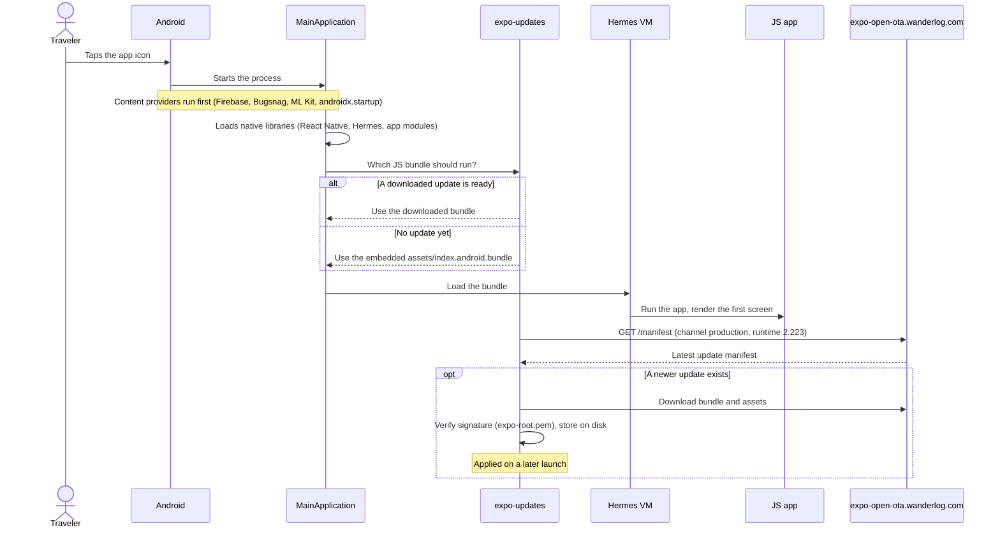

**Evidence:** `assets/app.config` (`updates.url`, `expo-channel-name: production`, `runtimeVersion 2.223`), `assets/app.manifest` (the embedded update, 487 assets), `assets/expo-root.pem`, manifest flag `expo.modules.updates.ENABLED`, providers `FirebaseInitProvider`, `BugsnagContentProvider`, `MlKitInitProvider`, `InitializationProvider`; bundle header is Hermes bytecode version 98.

### 3.2 Sign-in

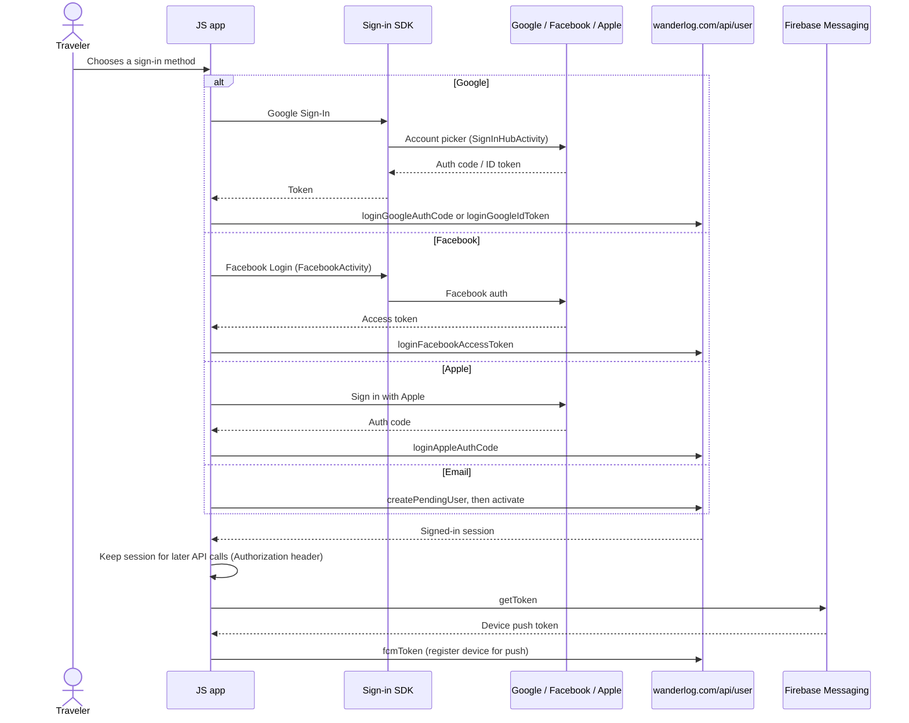

**Evidence:** routes `/api/user/loginGoogleAuthCode`, `/api/user/loginGoogleIdToken`, `/api/user/loginFacebookAccessToken`, `/api/user/loginAppleAuthCode`, `/api/user/createPendingUser`, `/api/user/activate`, `/api/user/isValidPasswordResetToken`, `/api/user/fcmToken`; classes `com.reactnativegooglesignin`, `com.google.android.gms.auth.api.signin.internal.SignInHubActivity`, `com.facebook.login`, `com.facebook.FacebookActivity`; strings `Authorization`, `getToken`, `onTokenRefresh`.

### 3.3 Planning a trip with tripmates (live sync)

Trip plans are shared documents. Every edit is sent as a small JSON operation over a websocket, and the server relays it to everyone else who has the trip open.

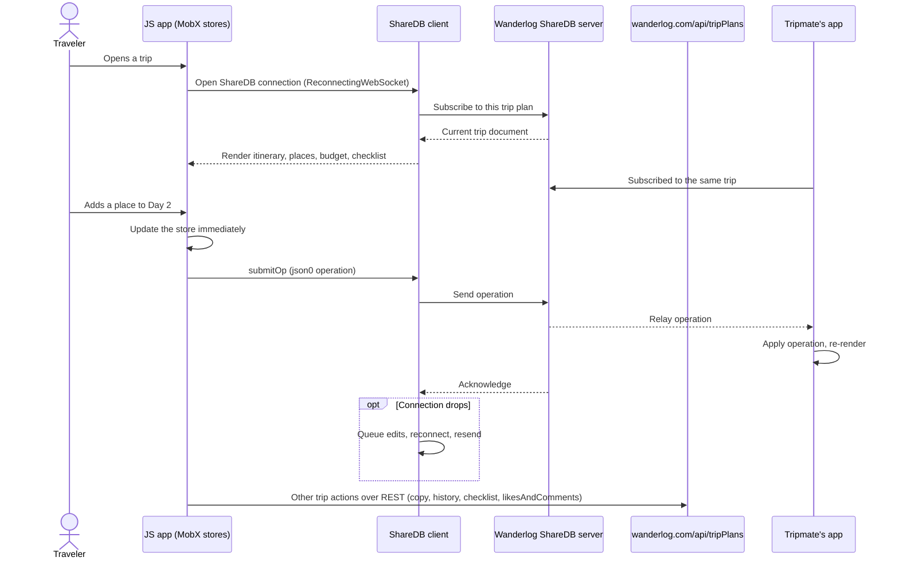

**Evidence:** strings `openShareDBConnection…`, `createErrorFromShareDBError`, `ReconnectingWebSocket`, `createSubscribeQuery`, `submitOp`, `json0`, `useTripPlanEventListener`, `useTripPlanKey`; routes `/api/tripPlans/copy`, `/api/tripPlans/history`, `/api/tripPlans/getIfEdited`, `/api/tripPlans/checklistSections`, `/api/tripPlans/likesAndComments`, `/api/tripPlans/feed`, `/api/events/subscribe/user`.

### 3.4 Searching places and showing them on the map

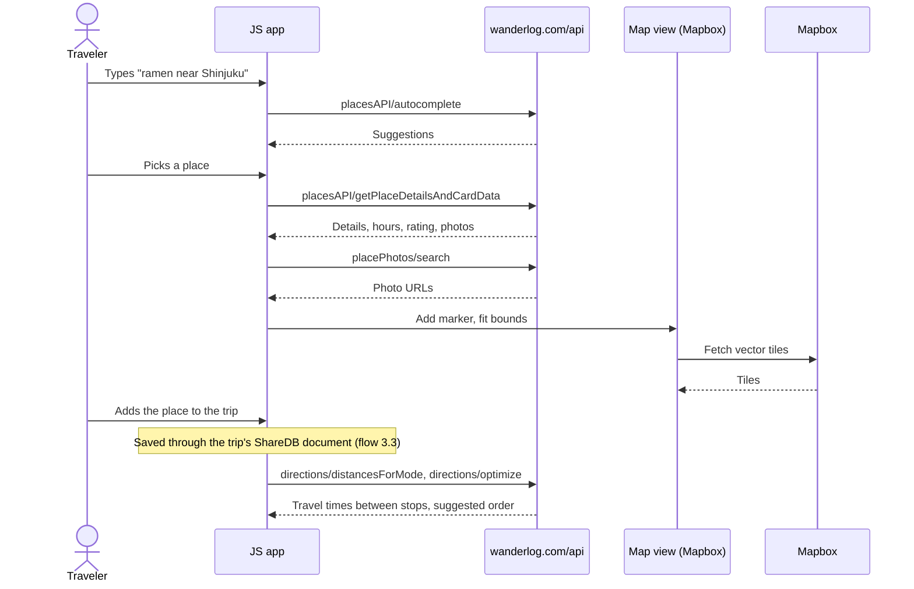

**Evidence:** routes `/api/placesAPI/autocomplete`, `/api/placesAPI/getPlaceDetails`, `/api/placesAPI/getPlaceDetailsAndCardData`, `/api/placePhotos/search`, `/api/geo/popularAndNearbyGeos`, `/api/geo/tripPlannerGeos`, `/api/directions/distancesForMode`, `/api/directions/optimize…`, `/api/recommendations`; native `libmapbox-maps.so`, `com.mapbox.maps`; Google Maps is also linked (`com.rnmaps.maps`, `com.google.android.gms.maps`).

### 3.5 Importing a booking by sharing a file

A traveler can share a confirmation email, PDF or screenshot to Wanderlog from another app, and it is turned into a reservation on their trip.

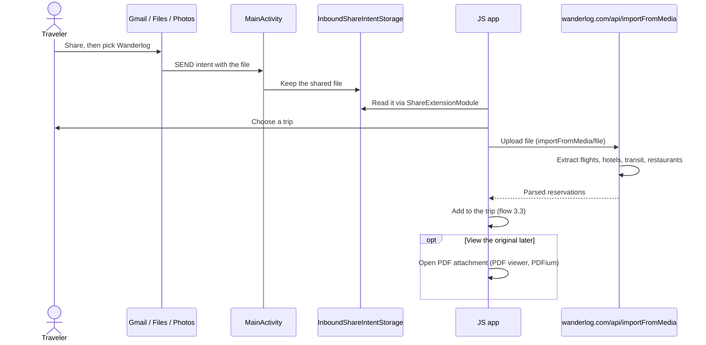

**Evidence:** classes `com.wanderlog.android.ShareExtensionModule`, `ShareExtensionPackage`, `InboundShareIntentStorage`; strings `useStartImportFromMediaFromFiles`, `importFromMedia/uploads`, `importFromMedia/thumbnails`, `importFromMedia/artifacts`, `importFromMediaInTripEntryPoint`, `createUploadTask`; route `/api/importFromMedia/file`; native `libpdfium.so`, classes `com.github.barteksc.pdfviewer`, `io.legere.pdfiumandroid`.

### 3.6 AI trip assistant

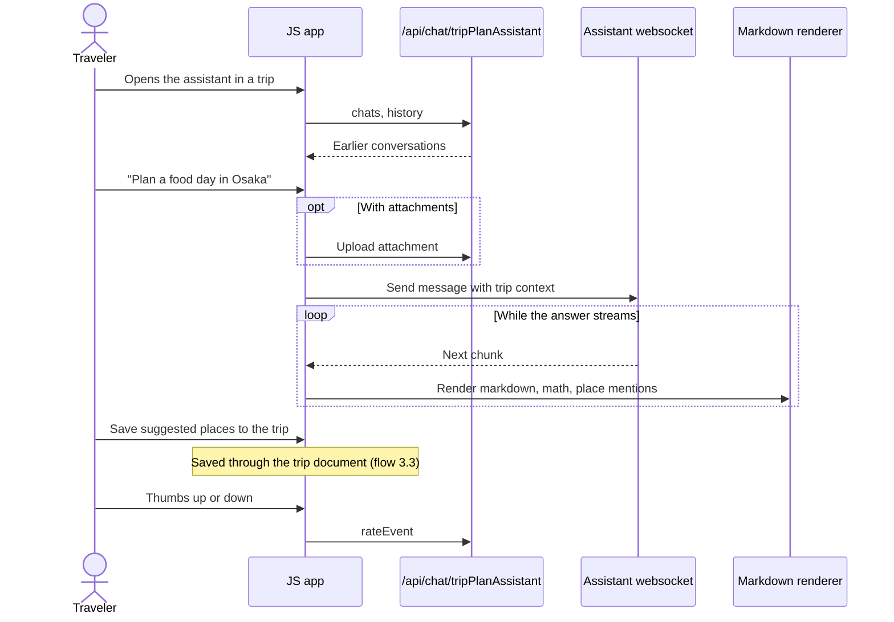

**Evidence:** routes `/api/chat/tripPlanAssistant/ws`, `/chats`, `/history`, `/initialChatWithItems`, `/attachment`, `/rateEvent`; strings `useTripPlanAssistantChatsSelectorHandlers`, `useMobileAssistantAttachmentUploading`, `useSaveAllPlacesForAssistantMessage`, `convertPlaceAnnotationsAndCleanMarkdownOutput`; native `libreact_codegen_EnrichedMarkdownTextSpec.so`, `libratex_ffi.so`, classes `com.swmansion.enriched.markdown`, `io.ratex`, KaTeX fonts in `assets/fonts`.

### 3.7 Hotel search and booking

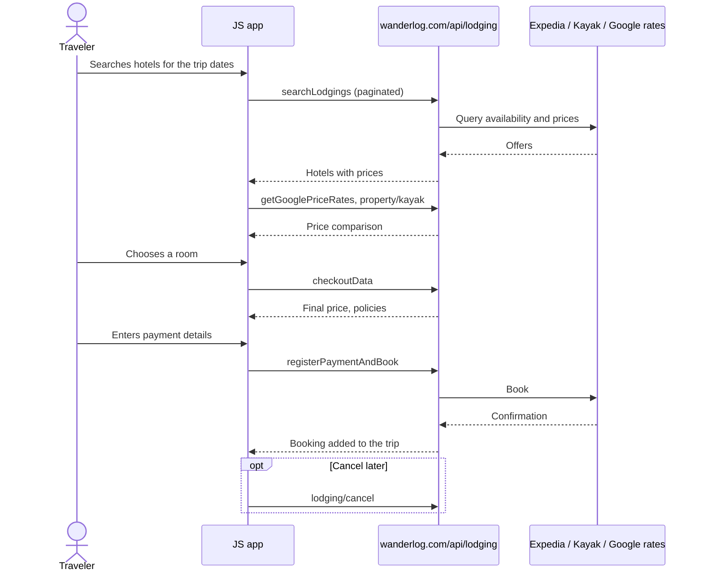

**Evidence:** routes `/api/lodging/searchLodgings`, `/api/lodging/getGooglePriceRates`, `/api/lodging/property/kayak`, `/api/lodging/checkoutData`, `/api/lodging/registerPaymentAndBook`, `/api/lodging/cancel`; strings `expediaBookingAPITimeoutMs`, `useLodgingSearchWithPagination`, `Kayak`, `Expedia`.

### 3.8 Pro subscription and offline access

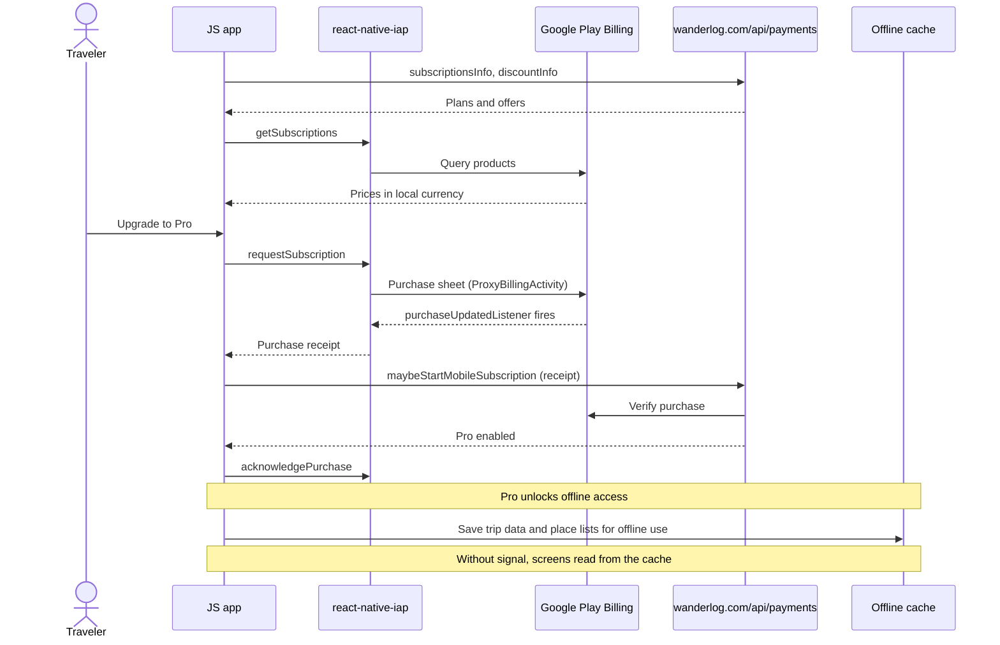

**Evidence:** classes `com.dooboolab` (react-native-iap), `com.android.billingclient.api.ProxyBillingActivity`, permission `com.android.vending.BILLING`; strings `getSubscriptions`, `requestSubscription`, `purchaseUpdatedListener`, `acknowledgePurchase`, `setOfflineAPICallCache`, `togglePlacesListSavedOffline`, `clickGetOfflineAccessInTemporaryModal`, `weeksBeforeTripToShowOfflineSubscribeModal`; routes `/api/payments/maybeStartMobileSubscription`, `/api/payments/subscriptionsInfo`, `/api/payments/discountInfo`. Stripe routes (`newStripeSubscription`, `startStripeTrial`) also exist but no Stripe SDK ships in the APK, so those serve the web version of the same codebase.

### 3.9 Trip tracking and travel journal

While a trip is on, the app can record where the traveler went in the background and turn the stops into a journal.

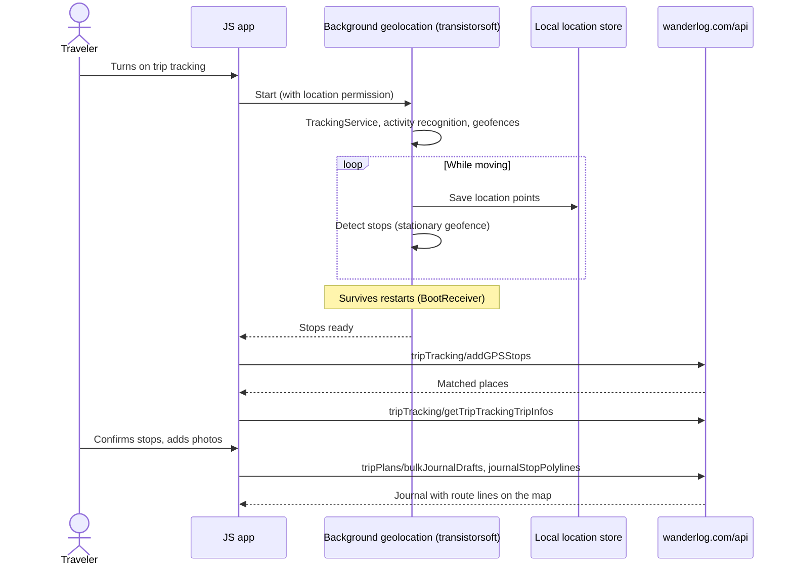

**Evidence:** native `libtslocationmanager.so`; manifest `com.transistorsoft.locationmanager.service.TrackingService`, `ActivityRecognitionService`, `GeofencingService`, `StationaryGeofenceReceiver`, `BootReceiver`, `com.transistorsoft.tsbackgroundfetch.FetchJobService`, `expo.modules.location.services.LocationTaskService`; strings `BackgroundGeolocation`, `makeConfirmedJournalStopFromGPSStop`, `setTripTrackingState`; routes `/api/tripTracking/addGPSStops`, `/api/tripTracking/getTripTrackingTripInfos`, `/api/tripPlans/bulkJournalDrafts`, `/api/tripPlans/journalStopPolylines`.

### 3.10 Push and local notifications

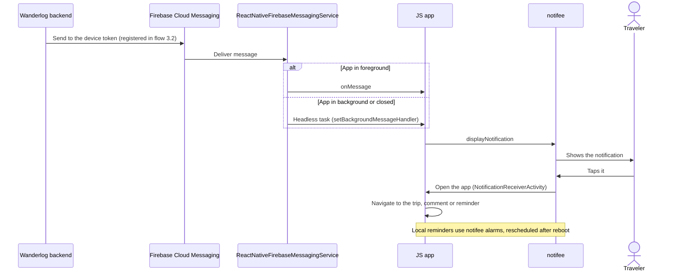

**Evidence:** manifest `io.invertase.firebase.messaging.ReactNativeFirebaseMessagingService`, `ReactNativeFirebaseMessagingHeadlessService`, `app.notifee.core.NotificationReceiverActivity`, `NotificationAlarmReceiver`, `RebootBroadcastReceiver`, `expo.modules.notifications.service.ExpoFirebaseMessagingService`; strings `onMessage`, `setBackgroundMessageHandler`, `displayNotification`, `cancelAllNotificationsWithIds`; route `/api/user/fcmToken`.

### 3.11 Deep links, analytics and crash reporting

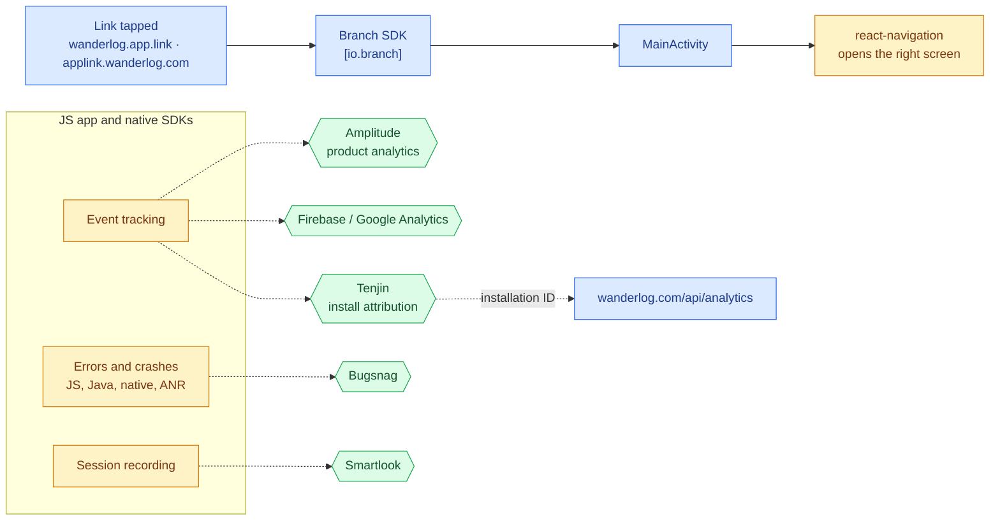

**Evidence:** classes `io.branch`, `com.amplitude`, `com.tenjin`, `com.bugsnag.android`, `com.smartlook`, `com.google.firebase.analytics`; native `libbugsnag-ndk.so`, `libbugsnag-plugin-android-anr.so`; manifest keys `io.branch.sdk.BranchKey`, `com.bugsnag.android.API_KEY`, `com.facebook.sdk.ApplicationId`; strings `wanderlog.app.link`, `applink.wanderlog.com`, `api2.amplitude.com`, `tenjinAnalyticsInstallationId`, `trackMobileSessionRecordingEvent`.

## 4. Backend API surface

Route groups found in the JS bundle, by how often they appear:

| Route group | Hits | Used for |
| --- | --- | --- |
| `/api/user` | 39 | Sign-in, sign-up, profile, following, push token, key-value settings |
| `/api/tripPlans` | 26 | Trips, feed, guides, copy, history, checklist, journal, likes and comments |
| `/api/geo` | 21 | Cities and regions, categories, popular and nearby places |
| `/api/payments` | 12 | Subscriptions, trials, discounts, lifetime Pro codes |
| `/api/placesAPI` | 8 | Place search, autocomplete, details |
| `/api/lodging` | 6 | Hotel search, checkout, booking, cancellation |
| `/api/chat` | 6 | AI trip assistant |
| `/api/misc` | 5 | Surveys, cookies, vulnerability reports, debug |
| `/api/places`, `/api/placePhotos`, `/api/placesList` | 11 | Place cards, photos, curated lists |
| `/api/flights` | 4 | Airline and airport search, flight stops |
| `/api/analytics` | 4 | Analytics IDs, test events |
| `/api/directions` | 3 | Travel times, route optimization |
| `/api/tripTracking` | 2 | GPS stops, tracked trip info |
| `/api/recommendations` | 2 | Suggestions, "not interested" feedback |
| Others | 1 each | `config`, `comments`, `events`, `emails`, `importFromMedia`, `mobileOnly`, `sessionStore`, `shareMap`, `wikivoyage` |
